<p align="center">
  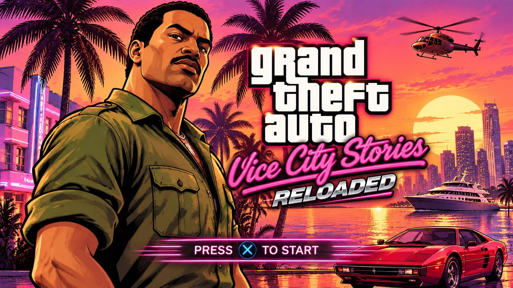
</p>

<h1 align="center">Grand Theft Auto: Vice City Stories Reloaded</h1>

<p align="center">
  <b>The PS2 game, recompiled to run natively on a jailbroken PS5: in 4K, at 60 fps, with GTA V's controls.</b>
</p>

<p align="center">
  4K at your TV's resolution &nbsp;·&nbsp; 60 fps &nbsp;·&nbsp; 16:9 widescreen &nbsp;·&nbsp; DualSense with GTA V's layout &nbsp;·&nbsp;
  weapon wheel &nbsp;·&nbsp; autosave &nbsp;·&nbsp; its own PS5 home screen
</p>

---

## What this is

Vice City Stories came out in 2006 for the PSP and 2007 for the PS2, and never had a PC or modern console release.
This project makes it a **native PS5 app**, without an emulator.

The game's program (the PS2's MIPS code) is translated ahead of time into C++ by a **static recompiler**, then
compiled for the PS5's own CPU. What the PS2's hardware did - its vector units, its graphics chip, its sound processor -
is done by the PS5 itself: the graphics are drawn by the PS5's GPU through Vulkan, at the resolution of your TV,
instead of being imitated pixel by pixel at the PS2's 640x448. The result is the original game, its story, missions
and physics unchanged, running the way a modern port would.

It builds on two projects: **[gta-vcs-recomp](https://github.com/gothamor/gta-vcs-recomp)** by gothamor (the
recompiled game, its runtime and native renderer, for PC) and **[gta4-ps5](https://github.com/elripalda/gta4-ps5)**
by elripalda (the PS5 toolchain that brought GTA IV to the PS5 the same way). This repository adds everything that
makes it a PS5 game.

> **No game files are included.** You need your own copy of the game (PS2, USA, SLUS-21590) as an `.iso`: the app
> reads the game's models, textures, sound, music and missions from it while it runs.

## Get it on RecompStore

The easiest way to play is **[RecompStore](https://recompstore.com)**. It installs the app, puts your disc image where
the game reads it, and keeps it up to date.

[](https://recompstore.com/game/PPSA94010)

## On a PS5

<p align="center">
  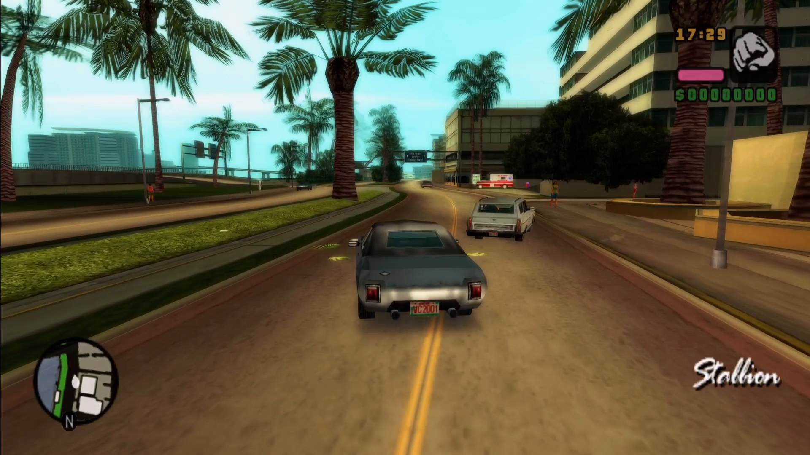
</p>

<p align="center">
  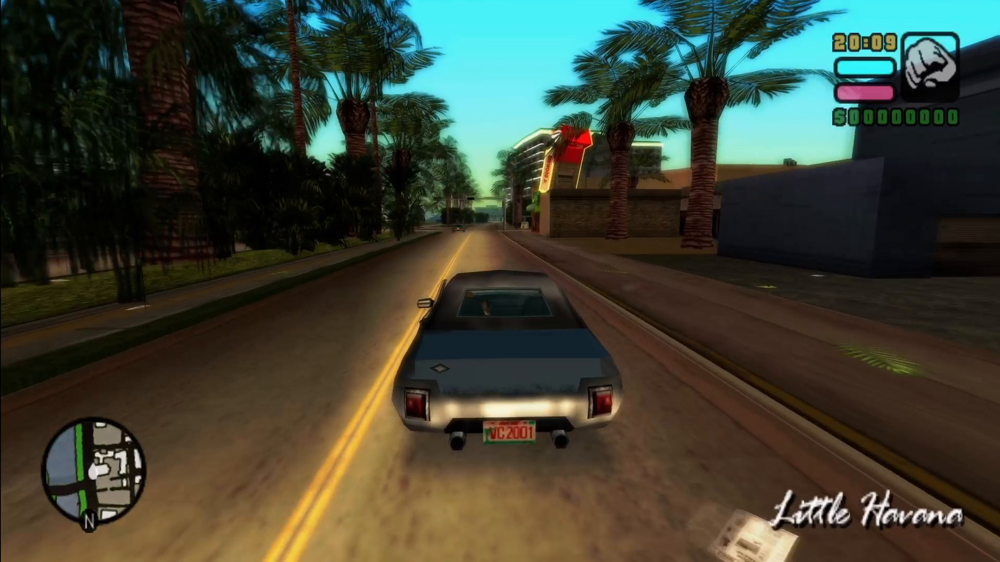
  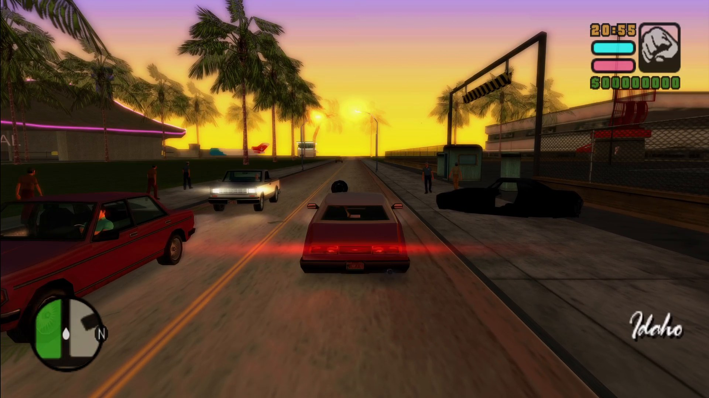
  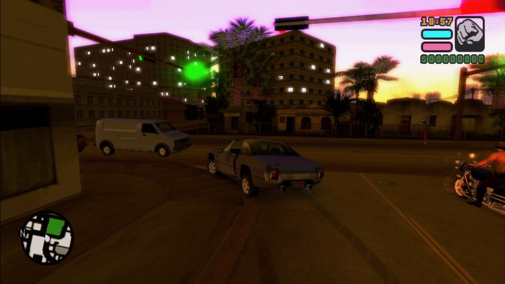
  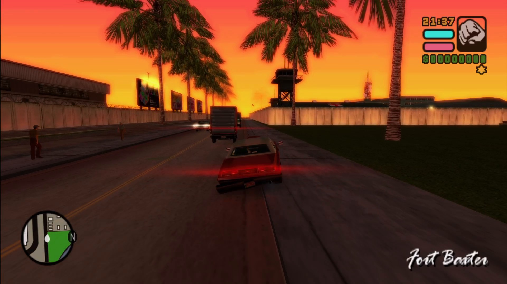
</p>

<p align="center"><i>Captured on a PS5 during play. The PS5 records clips at 1080p; on the TV the game is drawn in 4K.
More in the <a href="#gallery">gallery</a>.</i></p>

## What's new compared to the PS2

### Picture
- **4K**: the 3D world is drawn at your TV's own resolution (3840x2160 on a 4K TV), not upscaled from 640x448.
- **Widescreen 16:9** that shows more on the sides, not a stretched 4:3 picture. The HUD sits at the screen's
  edges, and the pause menu, its map and the loading screens fill the screen too.
- **Smoother edges and textures**: 2x multisample anti-aliasing and 16x anisotropic texture filtering.
- **A cleaner look**: contrast-adaptive sharpening and a colour grade (Original / Natural / Vivid), on the 3D picture
  only, so the HUD stays crisp. The game's own heavy glow is off by default, so lights and the sun no longer glare.
- **Your own sharper textures**: the game's textures can be dumped and replaced with higher-resolution versions.

### Frame rate
- **60 fps** on the PS5 (the PS2 ran at 30), at the TV's 59.94 Hz.
- **Everything still runs at the right speed**: cars, physics, mission timers, effects, smoke, rain, the radio and
  mission scripts are timed by the clock, not by frames. That's the work of gta-vcs-recomp, which fixed dozens of
  things that broke above 30 fps (missions that couldn't be finished, effects that ran too fast); its fixes that matter
  on the PS5 are brought into this repository as they come out.

### Controls: GTA V on the DualSense
- **GTA V's layout by default**: R2 / L2 to accelerate and brake or fire and aim, R1 + L1 for drive-bys, Circle for
  the cinematic camera, the radio on the d-pad, Circle to go back in menus.
- **A GTA V weapon wheel**: hold L1, point with the right stick, let go to equip. The game slows down while you choose,
  and a tap of L1 puts your weapon away.
- **The original PS2 layout is one choice away**: pause menu > Controls > **Setup 2** (Setup 1 is GTA V's). The
  Controls page's controller picture and the on-screen button prompts follow the layout you use, with PlayStation
  button symbols.
- Vibration on the DualSense.

<p align="center">
  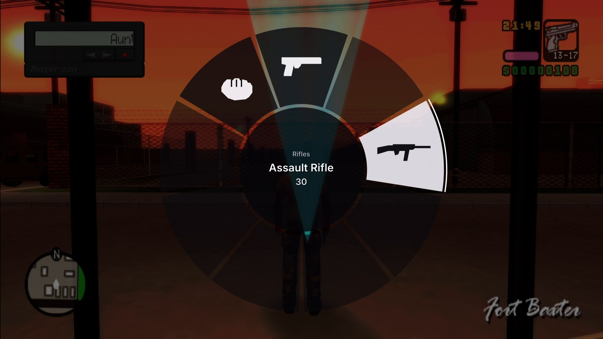
</p>
<p align="center"><i>The weapon wheel: hold L1, point with the right stick. The game slows down behind it.</i></p>

### Saving
- **Autosave**: about 20 seconds after each mission (passed or failed) and every 5 minutes in free roam, to slot 8 -
  your own saves in slots 1-7 are left alone. It saves exactly as a safehouse would, so loading an autosave puts you
  back where you were, with your weapons. A "Saving..." notice in the game's style shows in the corner.
- **The newest save loads at start-up**, and the memory card is backed up automatically before every save.

<p align="center">
  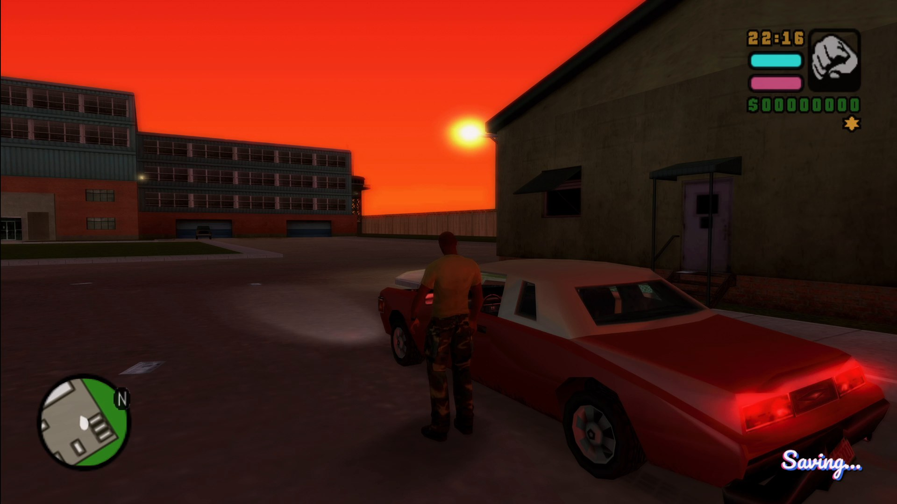
</p>
<p align="center"><i>An autosave: "Saving..." in the bottom right corner while the game keeps going.</i></p>

### A PS5 app of its own
- **Its own tile on the PS5 home screen**: the name *Grand Theft Auto: Vice City Stories Reloaded*, an icon, a
  background, and the theme music playing while the tile is selected.
- **"Press X to start"** after the loading screens, as GTA V does, over the Reloaded start screen above.
- The game's original logos, intro movie and loading screens, and its text with the PS2 / memory card wording
  replaced for the PS5.
- **A settings menu** (touchpad click + Options): picture, controls, autosave and more.

<p align="center">
  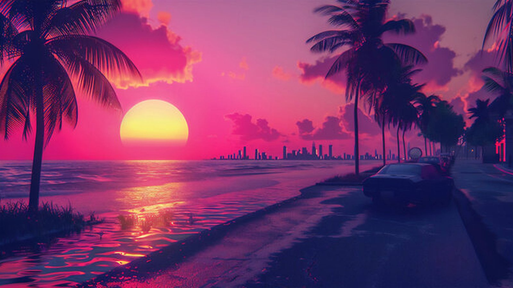
</p>
<p align="center"><i>The app's background on the PS5 home screen.</i></p>

## Gallery

All captured on a PS5 during one session of play.

<p align="center">
  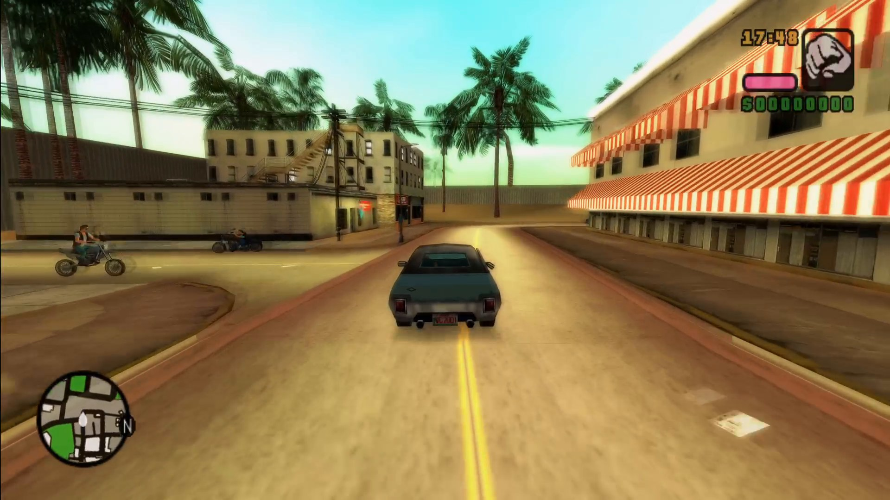
  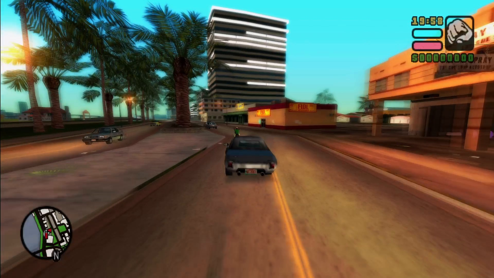
  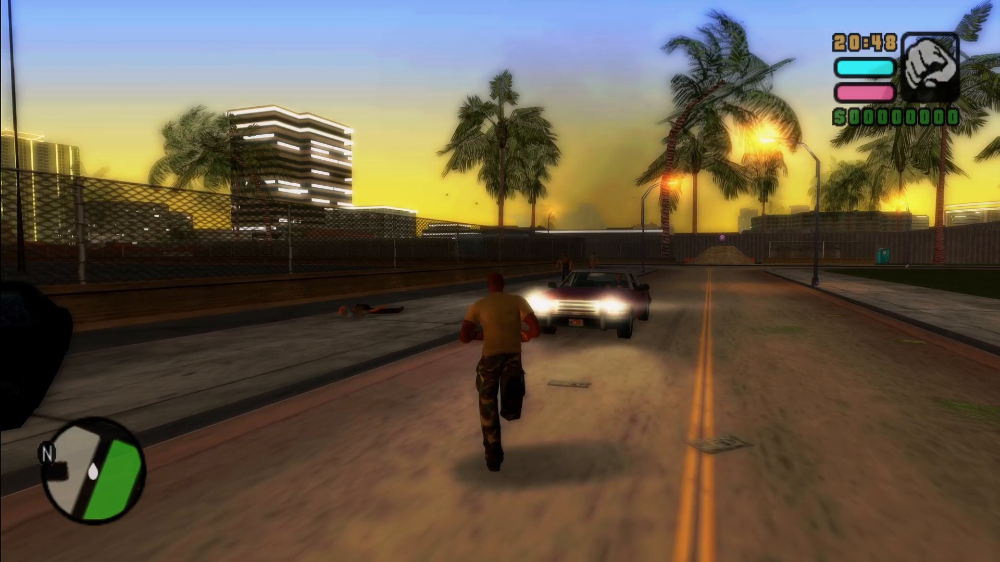
  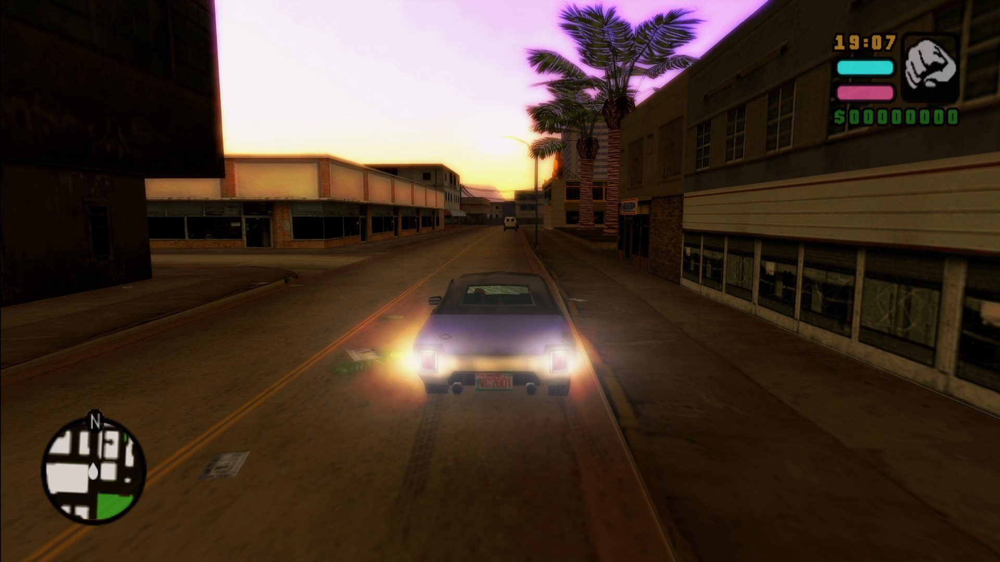
  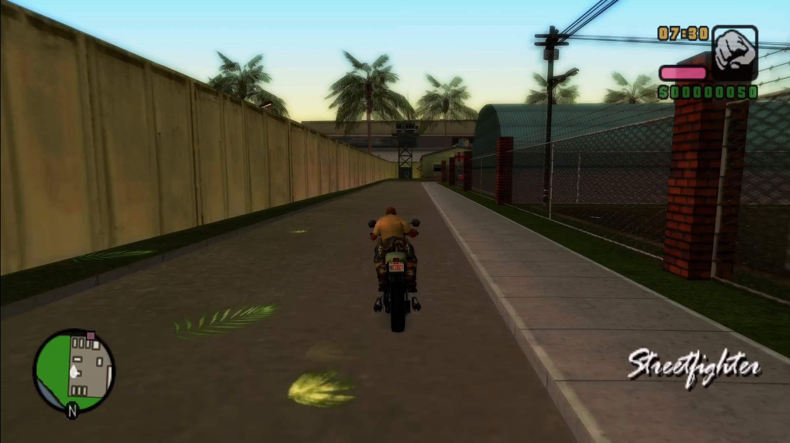
  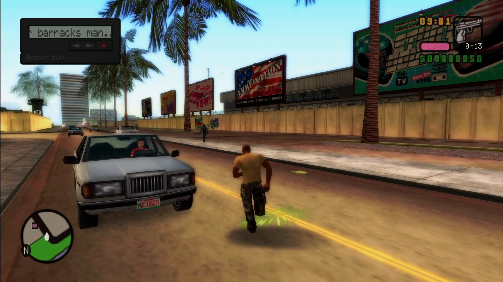
</p>

<p align="center">
  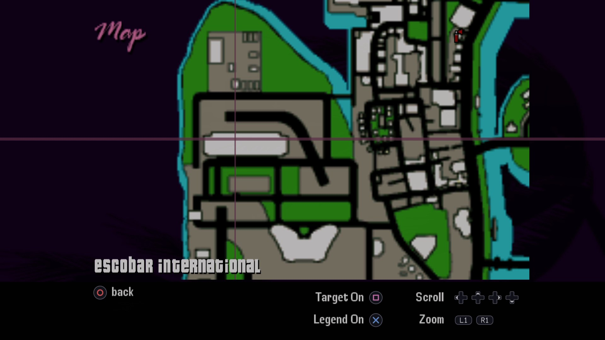
</p>
<p align="center"><i>The pause menu fills the 16:9 screen, its map too.</i></p>

## What you need

- A jailbroken PS5 that runs homebrew apps from `/data/homebrew/` (etaHEN or similar)
- Your **own** copy of Grand Theft Auto: Vice City Stories for the **PS2, USA (SLUS-21590)** as an `.iso`. No game
  files are included.
- Room for the app and your disc image (a few GB)

## Which disc works

| | Works |
|---|---|
| Disc | The **USA PS2** release of Grand Theft Auto: Vice City Stories, **SLUS-21590**, as an `.iso` (any file name) |
| Its program | `SLUS_215.90`, SHA-1 `d1832508caf0990c2291c0f255c96a889cce9f88` |

These don't work: the European or other PS2 releases (SLES-...), the PSP version, and a modified or damaged rip. The
app is made from the USA disc's program, so it needs that disc's files.

## Install by hand

1. Download `PPSA94010.zip` from [Releases](../../releases) and copy the `PPSA94010` folder to `/data/homebrew/` on
   your PS5.
2. Put your disc image in its `disc` folder:

```
/data/homebrew/PPSA94010/disc/Grand Theft Auto - Vice City Stories (USA).iso
```

3. Start **Grand Theft Auto: Vice City Stories Reloaded** from the home screen (ShadowMountPlus or your homebrew
   launcher adds it).

To update, copy the new `PPSA94010` folder over the old one. Your disc image, saves and settings stay.

## Known issues

- Occasional short stutters while the world streams in at speed (the game loading new areas).
- Only the USA PS2 disc is supported.
- 120 Hz / VRR isn't offered yet; the game runs at 60 FPS on a 60 Hz output.

## Reporting a problem

Open an [issue](../../issues) with what you were doing, and attach the log: `/data/homebrew/PPSA94010/logs/vcs.log`.
If the game froze or crashed, put a file called `env.txt` holding the line `VCS_LOG_SYNC=1` in the app's folder first,
so the log keeps everything up to the moment it stopped.

## Source

This repository holds the releases. The port is built on [gta-vcs-recomp](https://github.com/gothamor/gta-vcs-recomp)
by gothamor, with the PS5 tooling of [gta4-ps5](https://github.com/elripalda/gta4-ps5) by elripalda.

## How it works

```
your PS2 disc (.iso)
   │  tools/vcs_disc.py         the game's program, read from the disc
   ▼
SLUS_215.90 (MIPS R5900)
   │  PS2Recomp                  every function translated to C++ (game/vcs: the function map and config)
   ▼
generated/ (C++, stays on your PC)
   │  the PS5 SDK's clang         + the runtime (PS2 hardware on the PS5), the native renderer, the PS5 layer
   ▼
the PS5 app (PPSA94010)          Vulkan (RADV) on the GPU, libScePad, libSceAudioOut
```

## What's next

- 120 Hz / VRR as an option.
- **Liberty City Stories**, the same way.

## Credits

- **[gothamor](https://github.com/gothamor)**: gta-vcs-recomp - the recompiled game, its runtime, the native renderer
  and the fixes above 30 fps
- **[ran-j](https://github.com/ran-j)**: [PS2Recomp](https://github.com/ran-j/PS2Recomp), the static recompiler
- **[elripalda](https://github.com/elripalda)**: gta4-ps5, whose PS5 tooling this reuses
- **[Nazky](https://github.com/Nazky)**: ps5-plume-triangle
- **[mihawk-99](https://github.com/mihawk-99)**: PS5_Mesa, the PS5 Vulkan driver
- **[ps5-payload-dev](https://github.com/ps5-payload-dev)**: the PS5 payload SDK
- Fonts: Inter and Pacifico (SIL Open Font License)

Licensed under GPL-3.0, like gta-vcs-recomp and gta4-ps5. Grand Theft Auto: Vice City Stories is © Rockstar Games /
Take-Two Interactive. This project is not affiliated with or endorsed by them. No game files are included: every
player needs their own copy of the game.
